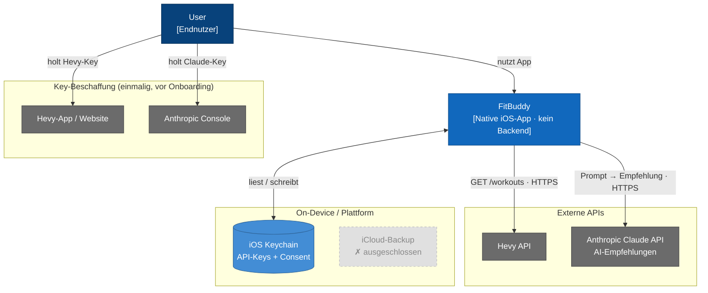

# FitBuddy — Architektur

> *Getrennt geführt: Ziele, Personas, Risiken → [README.md](../README.md) · User Stories, NFRs → [REQUIREMENTS.md](REQUIREMENTS.md) · Architekturentscheide (Detail) → [adr/](adr/)*

---

## Inhalt

- [Kontextabgrenzung](#kontextabgrenzung)
  - [Akteure & externe Systeme](#akteure--externe-systeme)
  - [Bewusste Leerstellen](#bewusste-leerstellen)
- [Lösungsstrategie](#lösungsstrategie)
- [Bausteinsicht](#bausteinsicht)
  - [L1 — Gesamtsystem (Container)](#l1--gesamtsystem-container)
  - [L2 — iOS App (Schichtenarchitektur)](#l2--ios-app-schichtenarchitektur)
  - [L3 — Komponenten](#l3--komponenten-folgt-in-modul-5--coding-phase)
  - [Connector-Interface](#connector-interface)
  - [Normalisiertes Datenmodell](#normalisiertes-datenmodell)
- [Laufzeitsicht](#laufzeitsicht)
  - [Kritischer Datenfluss — «Analysieren» (US-3)](#kritischer-datenfluss--analysieren--us-3)
  - [Caching-Strategie](#caching-strategie)
- [Querschnittliche Konzepte](#querschnittliche-konzepte)
  - [AI-Einsatzstrategie](#ai-einsatzstrategie)
  - [Swift Concurrency-Konvention](#swift-concurrency-konvention)
- [Architekturentscheide](#architekturentscheide)
- [Risiken & Technische Schulden](#risiken--technische-schulden)
- [Offene Fragen](#offene-fragen)
  - [Widersprüche & Unklarheiten](#widersprüche--unklarheiten)
  - [Offene Architektur-Fragen](#offene-architektur-fragen)

---

## Kontextabgrenzung



### Akteure & externe Systeme

| Element | Typ | Scope | Zweck |
|---|---|---|---|
| User | Person | — | Endnutzer (Training-Tracking + AI-Analyse) |
| FitBuddy Team | Person (Betreiber) | — | Entwickelt/betreibt App; kein eigener DPA mit Anthropic nötig (BYO-Key-Modell) |
| **FitBuddy** | Software-System | **PoC** | Native iOS-App, Datenaggregation + On-demand-AI |
| Hevy API | Externes System | PoC | Primäre Datenquelle (Kraft) |
| Anthropic Claude API | Externes System | PoC | LLM-Progressionsempfehlung (USA, Drittland) |
| Apple App Store Connect / TestFlight | Externes System | PoC | Distribution + Review-Gate + Privacy Report |
| iOS Keychain | Plattform-Service | PoC | Sichere Key-/Consent-Speicherung |
| Apple HealthKit | Plattform-Service | **offen** | Schlaf/HRV/RHR — Scope ungeklärt |
| iCloud-Backup | Externes System | **ausgeschlossen** | `isExcludedFromBackup` — kein Datenfluss |

### Bewusste Leerstellen

Im PoC absichtlich nicht vorhanden: Auth-Provider/User-Accounts (Auth = Bearer-Keys im Keychain → kein Cross-Device, keine Account-Recovery), E-Mail/Push (US-11 = Won't), Monetarisierung, Analytics-Dienst.

---

## Lösungsstrategie

FitBuddy ist eine **on-device iOS-App ohne Server-Tier**: alle Daten bleiben auf dem Gerät, alle API-Calls laufen direkt vom iPhone, und der einzige externe Zustand sind die API-Keys zweier Drittanbieter (Hevy, Anthropic).

| Schicht | Technologie | Begründung |
|---|---|---|
| Plattform | iOS (native Swift / SwiftUI) | API-Key lokal im Keychain; null Drittanbieter-Abhängigkeiten |
| AI | Claude API (Anthropic) | On-demand, kein eigenes ML-Training |
| Primäre Datenquelle | Hevy REST API | PoC-Quelle; Pro-User haben API-Key |
| Lokaler Speicher | iOS Keychain + SwiftData (SQLite) | Privacy-First: keine User-Daten auf eigenen Servern |

**Kein Backend im PoC.** Der Claude API-Key wird direkt im Keychain gespeichert — vereinfacht den PoC erheblich, muss vor v1.0-Launch überprüft werden (→ ADR-004). Die Apple-native Technologiewahl (SwiftUI, SwiftData, URLSession, Swift Concurrency, Swift Charts) eliminiert Drittanbieter-Build-Abhängigkeiten und senkt die Einarbeitungshürde für ein gemischtes Team.

---

## Bausteinsicht

### C2 Container Diagram

FitBuddy besteht aus drei on-device-Bausteinen (iOS App, SwiftData Store, iOS Keychain) und kommuniziert direkt mit zwei externen APIs — kein Backend.


| Container | Technologie | Kritischstes Risiko |
|---|---|---|
| **iOS App** | Swift · SwiftUI · MVVM · Swift Concurrency | Actor-Isolation-Fehler crashen erst zur Laufzeit |
| **SwiftData Store** | SwiftData (`@Model`) · SQLite · on-device | Stille Store-Löschung bei fehlender `VersionedSchema` |
| **iOS Keychain** | Keychain Services · `kSecAttrAccessibleWhenUnlockedThisDeviceOnly` | Kein Recovery-Pfad bei verlorenem Key |

*Bewusst nicht vorhanden: Web-App, API-Server, Server-Datenbank, verteilter Cache, Message Queue (ADR-004).*

### L2 — iOS App (Schichtenarchitektur)

Zoom in den iOS-App-Container: vier strikt getrennte Schichten, die von oben nach unten Verantwortung delegieren.


**Schichtregeln:**
- API-Keys berühren ausschliesslich den Data Layer — nie ViewModel oder View.
- Dashboard und InferenceService lesen ausschliesslich aus dem normalisierten `Activity`-Modell (ADR-006).
- Alle SwiftData-Schreibzugriffe laufen über `ModelActor`, nie direkt auf dem `@MainActor`.

---

## Laufzeitsicht

### Kritischer Datenfluss — «Analysieren» (US-3)

```
[1] Keychain Read      → Claude API-Key lesen (<1ms, synchron)
[2] SwiftData Query    → Workouts 90 Tage laden (async, ModelActor)
[3] Prompt-Build       → Daten serialisieren (kein Token-Limit definiert ⚠)
[4] HTTPS POST         → api.anthropic.com (5–30s, kein Streaming, kein Retry ⚠)
[5] Response parsen    → AI-Empfehlung extrahieren
[6] SwiftData Write    → Cooldown-Timestamp speichern (Race Condition ⚠)
[7] @MainActor Update  → SwiftUI re-rendert Ergebnis
```

| Lücke | Konsequenz |
|---|---|
| Kein Token-Limit (Schritt 3) | `400 context_length_exceeded` bei 90 Tagen × vollem Trainingsvolumen |
| Cooldown-Write nach API-Call (Schritt 6 nach 4) | Crash-Window → doppelte Analyse-Kosten möglich |
| Kein Backgrounding-Handling (Schritt 4) | iOS beendet URLSession-Task nach ~30s — Analyse verloren, kein User-Feedback |

### Caching-Strategie

| Szenario | Verhalten |
|---|---|
| Erster Start / connect() | Vollständiger Load via `GET /v1/workouts` (alle Seiten paginiert, max 10/Page) + Template-Cache befüllen |
| Folge-Syncs | Delta-Sync via `GET /v1/workouts/events?since=<lastSyncTimestamp>` — nur `"updated"` und `"deleted"` Events |
| Event-Typ `"deleted"` | Workout lokal aus Cache entfernen |
| API nicht erreichbar | Gecachte Daten anzeigen mit Hinweis auf letzten Sync (US-2 AC2) |
| Pull-to-Refresh (US-10) | Delta-Sync erzwingen; bei Fehler Cache behalten |
| HTTP 401 | Key aus Keychain löschen, Onboarding-Flow starten (US-1 AC3) |

> **Pagination:** Hevy erlaubt max. 10 Workouts pro Page. Für 90 Tage (~65 Workouts bei 5×/Woche) sind ~7 API-Calls nötig. `HevyConnector` kapselt die Pagination-Loop intern — `fetchActivities(since:)` gibt immer eine vollständige Liste zurück.

---

## Querschnittliche Konzepte

### AI-Einsatzstrategie

Systemweite Regel: Claude wird nur dort eingesetzt, wo deterministischer Code keine ausreichende Lösung bietet.

| Bereich | AI? | Begründung |
|---|---|---|
| Progressions-Empfehlung | Ja (LLM) | Interpretation von Trainingsdaten erfordert Kontext-Verständnis |
| Datenabruf (Hevy API) | Nein | Klassische App-Logik |
| Aggregation & Visualisierung | Nein | Deterministisch, kein AI-Mehrwert |
| Key-Speicherung | Nein | iOS Keychain ist die richtige Lösung |

**Prompt-Engineering (US-3)** — Eingabe: Strukturierte Trainingsdaten der letzten 4 Wochen (Volumen, Frequenz, Übungshistorie, Set-Typen, RPE-Werte).

System-Prompt definiert: Verbotene Termini (Fachjargon), Ausgabeformat («1 Satz Lage · 1 konkrete Aktion · 1 optionaler Hinweis»), medizinischen Disclaimer, English-only output.

> **RPE-Nutzung:** `ExerciseSet.rpe` (6–10) gibt Claude Aufschluss über subjektive Anstrengung — ermöglicht Empfehlungen wie *"Your RPE has been consistently at 9+ for squats — consider a deload week."*

### Swift Concurrency-Konvention

Alle asynchronen Zugriffe folgen drei fixen Ausführungskontexten — gilt schichtübergreifend für alle Komponenten:

| Kontext | Verwendung | Grund |
|---|---|---|
| `@MainActor` | ViewModels · alle UI-State-Updates | SwiftUI erfordert Main Thread für Rendering |
| `ModelActor` | Alle SwiftData-Schreibzugriffe | Verhindert Datenkorrumption bei konkurrierenden Writes |
| `async` (background) | URLSession-Calls · Keychain-Zugriffe | Blockiert nicht den Main Thread |

**Regeln (gelten für alle Schichten):**
- SwiftData-Writes nie direkt auf `@MainActor` — immer über `ModelActor`
- ViewModel-Properties nie aus einem background Task ohne `await MainActor.run { }` setzen
- `HevyConnector` und `InferenceService` sind `async`-only — nie synchron aufgerufen

*`ExerciseTemplateCache` (Implementierungsdetail Data Layer) → folgt in L3 Bausteinsicht.*

---

## Architekturentscheide

| ADR | Titel | Status |
|---|---|---|
| [ADR-001](adr/ADR-001-local-database.md) | Lokale Datenbank — SwiftData als Persistenz-Technologie | Proposed |
| [ADR-002](adr/ADR-002-native-ios-swiftui.md) | Native iOS (SwiftUI) als Plattform | Proposed |
| [ADR-003](adr/ADR-003-keychain-this-device-only.md) | API-Keys im iOS Keychain mit `kSecAttrAccessibleWhenUnlockedThisDeviceOnly` | Proposed |
| [ADR-004](adr/ADR-004-no-backend-proxy-poc.md) | Kein Backend-Proxy im PoC — Direkter API-Call vom iOS-Client | Proposed |
| [ADR-005](adr/ADR-005-claude-api-usa-with-dpa.md) | Claude API (USA) via Anthropic Commercial Terms im PoC, EU-Hosting vor v1.0 | Proposed |
| [ADR-006](adr/ADR-006-fitness-connector-protocol.md) | `FitnessConnector`-Protocol als Abstraktion ab Sprint 1 | Proposed |

---

## Risiken & Technische Schulden

### Architektonische Risiken

| # | Risiko | Impact | Mitigation |
|---|---|---|---|
| AR-1 | **Hevy API ohne SLA-Garantien** — Hevy hat Stabilität explizit nicht zugesichert (*"no guarantees — we might abandon this entirely"*). Hevy ToS auf kommerzielle API-Nutzung noch nicht geprüft. | Hoch | `FitnessConnector`-Protocol (ADR-006) — zweite Quelle ohne Umbau integrierbar |
| AR-2 | **Hevy Events-Endpoint als "early development" markiert** — Breaking Changes ohne Vorankündigung möglich | Mittel | Fallback auf vollständigen Re-Fetch bei HTTP-Fehler im `HevyConnector` einbauen |

*AR-1 entspricht R1 in [README.md](../README.md).*

### Technische Schulden

Bekannte Lücken im PoC-Design — vor Sprint 3 (AI-Integration) adressieren:

| # | Lücke | Konsequenz | Handlungsbedarf |
|---|---|---|---|
| TD-1 | **Kein Token-Limit im Prompt-Build** | `400 context_length_exceeded` bei 90 Tagen × vollem Trainingsvolumen | Prompt-Fenster als Konstante definieren (→ W-2); Daten vor API-Call kürzen |
| TD-2 | **Cooldown-Write nach API-Call** | Crash-Window → doppelte Analyse-Kosten möglich | Cooldown-Timestamp **vor** dem API-Call schreiben; bei Fehler zurücksetzen |
| TD-3 | **Kein Backgrounding-Handling beim Claude-Call** | iOS beendet URLSession-Task nach ~30s — Analyse verloren, kein Benutzer-Feedback | `URLSession` mit `background`-Konfiguration oder explizites Timeout + Benutzer-Feedback |

---

## Offene Fragen

### Widersprüche & Unklarheiten

*Vor Sprint 1 auflösen.*

| # | Widerspruch / Unklarheit | Betroffene Dokumente | Handlungsbedarf |
|---|---|---|---|
| W-3 | **Certificate Pinning: als aktiv formuliert, laut ADR noch nicht implementiert.** ADR-004 markiert es als «Pflicht in Sprint 2». | `ADR-004` | Formulierung korrigieren: «geplant, Sprint 2». |
| W-4 | **6h-Cooldown-Speicherort undefiniert.** ADR-004 nennt «6h via UserDefaults». ADR-001 reserviert UserDefaults nur für den Sync-Zeitstempel. Kein Dokument definiert den konkreten Key. | `ADR-004`, `ADR-001` | UserDefaults-Key-Konvention (`fitbuddy.analysis.lastCooldownTimestamp`) in ADR-001 oder ADR-004 ergänzen. |
| W-5 | **HealthKit: Entscheid gefordert, aber nirgends getroffen.** Das `Activity`-Modell ist deshalb noch nicht finalisierbar. | `ADR-006` | Entscheid blockiert Protocol-Design und Datenmodell. Empfehlung: OUT für PoC. |
| W-6 | **Strava OAuth-Secret ohne Backend strukturell unlösbar.** Secret in App einbetten ist nicht akzeptabel. Polar Accesslink (PKCE, kein Secret) ist eine Backend-freie Alternative — Entscheid steht aus. | `ADR-004`, `ADR-006` | Vor v1-Implementierung: Strava (Backend nötig) oder Polar (kein Backend) als zweite Quelle festlegen — eigener ADR. |

### Offene Architektur-Fragen

| Frage | Priorität |
|---|---|
| Apple Health: Schlaf, HRV, Ruheherzrate — IN oder OUT? Wenn IN: passiver HealthKit-Zugriff, kein Connector nötig, aber `Activity`-Modell und Privacy Manifest ändern sich | Hoch — blockiert Sprint 1 |
| AUP-Status geprüft: Kein AUP-Verbot für BYO-Key / Direct-from-Mobile. Anthropics Best Practice («eigener Key pro User») ist durch den BYO-Ansatz erfüllt. Intern in ADR-004 dokumentiert — kein Support-Gate. | Erledigt (Sprint 1) |
| Fehlerzustand 401: harter Logout vs. weicher Banner | Mittel — Empfehlung: harter Logout im PoC |
| `ExerciseTemplateCache`: SwiftData oder In-Memory-Dictionary mit UserDefaults-Persistenz? | Mittel — vor US-2 entscheiden |
