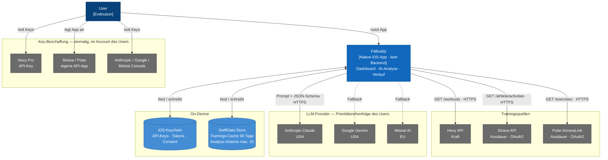
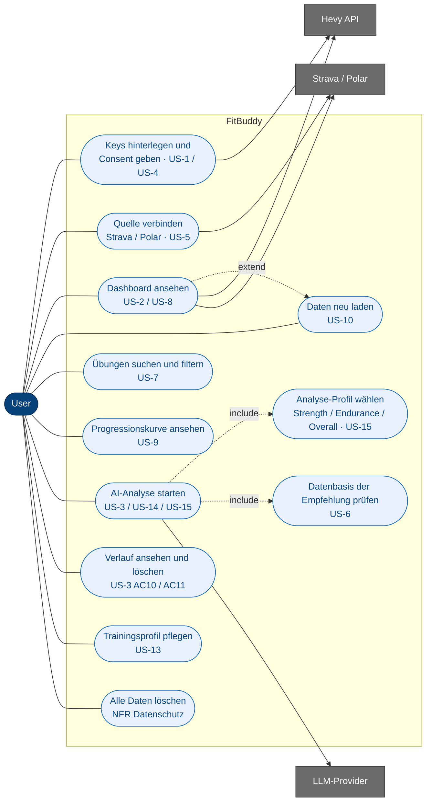
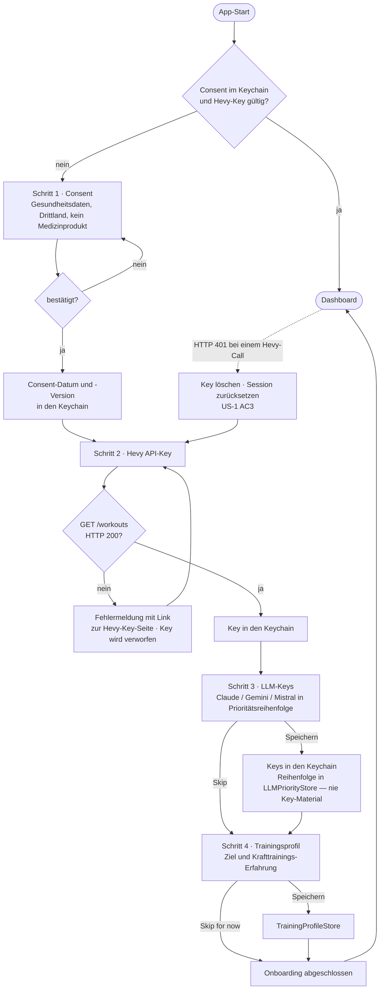
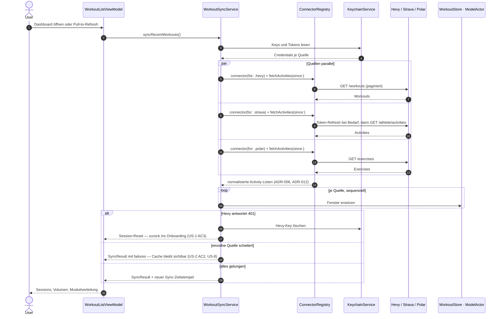
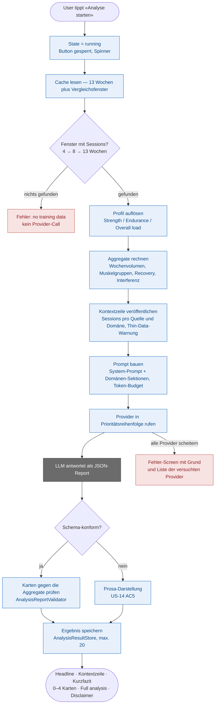
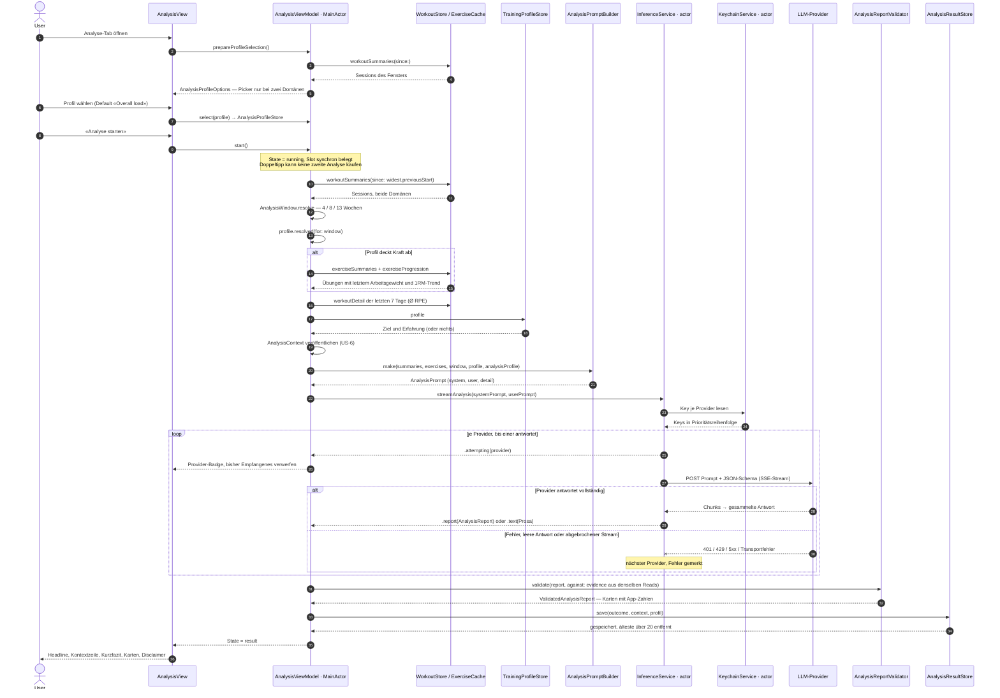
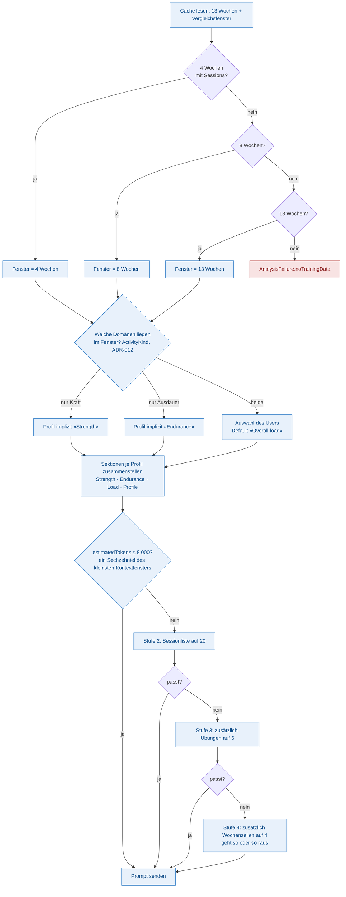
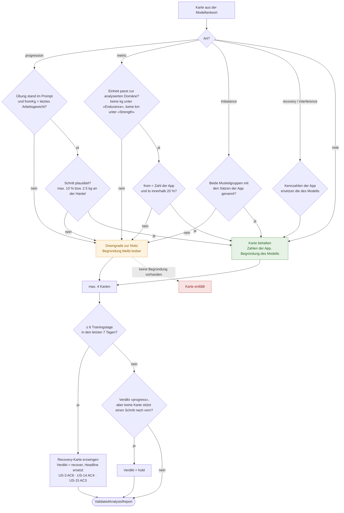
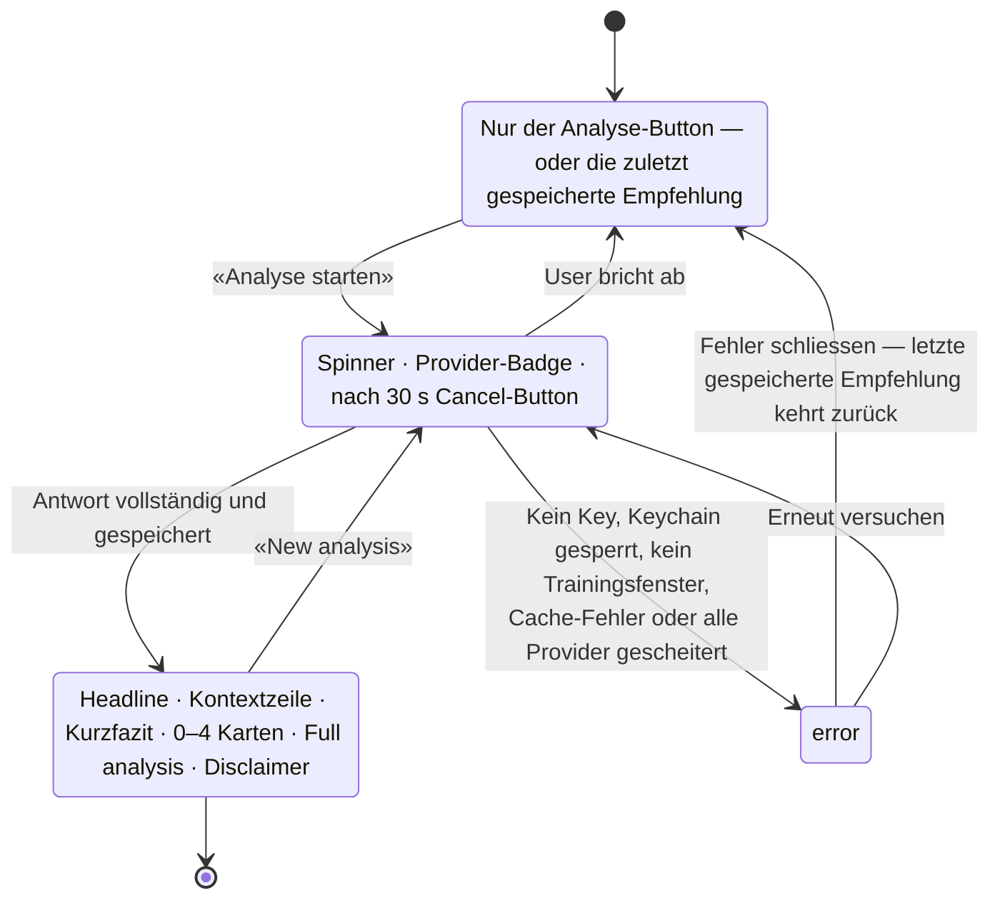

# FitBuddy — Diagramme

> *Alle Diagramme als Mermaid, direkt auf GitHub renderbar. Ergänzt [ARCHITECTURE.md](ARCHITECTURE.md) um die Ablaufsicht — Bausteine, Datenmodell und Entscheide stehen dort, die User Stories in [REQUIREMENTS.md](REQUIREMENTS.md).*

Schwerpunkt dieses Dokuments ist der **AI-Analyse-Teil** (Kapitel 5): vom Tap auf «Analyse starten» über Prompt-Build, Fallback-Kette und Karten-Validierung bis zur gespeicherten Empfehlung.

---

## Inhalt

- [1. Kontextdiagramm](#1-kontextdiagramm)
- [2. Use-Cases](#2-use-cases)
- [3. Ablauf — Onboarding](#3-ablauf--onboarding)
- [4. Ablauf — Sync der Trainingsdaten](#4-ablauf--sync-der-trainingsdaten)
- [5. AI-Analyse](#5-ai-analyse)
  - [5.1 Überblick](#51-überblick--was-beim-tap-auf-analysieren-passiert)
  - [5.2 Sequenzdiagramm](#52-sequenzdiagramm--ein-vollständiger-analyse-lauf)
  - [5.3 Prompt-Build](#53-prompt-build--fenster-profil-und-token-budget)
  - [5.4 Fallback-Kette](#54-fallback-kette-über-die-llm-provider)
  - [5.5 Karten-Validierung](#55-karten-validierung--jede-zahl-ist-die-der-app)
  - [5.6 Zustände des Analyse-Screens](#56-zustände-des-analyse-screens)
- [6. Wo die Diagramme im Code stehen](#6-wo-die-diagramme-im-code-stehen)

---

## 1. Kontextdiagramm

FitBuddy läuft vollständig auf dem iPhone. Es gibt kein Backend: Die App spricht direkt mit drei Trainingsquellen und bis zu drei LLM-Providern, jeweils mit den Keys des Nutzers (BYO-Key, [ADR-004](adr/ADR-004-no-backend-proxy-poc.md), [ADR-007](adr/ADR-007-multi-provider-llm-byo-key.md), [ADR-010](adr/ADR-010-strava-oauth-byo-app.md), [ADR-011](adr/ADR-011-polar-als-dritte-quelle.md)).

**Bewusst nicht vorhanden:** Server, User-Accounts, Push-Dienst, Analytics, iCloud-Backup der App-Daten.

---

## 2. Use-Cases

Mermaid kennt kein UML-Use-Case-Diagramm; die Darstellung bildet Akteur, Anwendungsfälle und externe Systeme als Graph ab. In Klammern die zugehörige User Story aus [REQUIREMENTS.md](REQUIREMENTS.md).

Nicht enthalten, weil bewusst ausgeschlossen (Kapitel 4 in REQUIREMENTS.md): Push-Wochenübersicht (US-11) und Rückschreiben nach Hevy (US-12).

---

## 3. Ablauf — Onboarding

Vier Schritte, zwei davon überspringbar. Ohne Consent gibt es keinen Zugang zur App (US-4 AC4).

Strava und Polar werden **nicht** im Onboarding verbunden, sondern in den Settings — Schritt 4 weiss deshalb nicht, ob eine Kraft- oder eine Ausdauersportlerin davorsitzt (US-13).

---

## 4. Ablauf — Sync der Trainingsdaten

`WorkoutSyncService` holt das 90-Tage-Fenster von jeder verbundenen Quelle parallel und schreibt die Ergebnisse nacheinander in den Store — eine Quelle, die scheitert, nimmt die anderen nicht mit.

Die Analyse löst **nie** einen Sync aus: Sie liest ausschliesslich den lokalen Cache, damit ein Tap auf «Analysieren» nicht an Konnektivität scheitert, die das Dashboard schon behandelt.

---

## 5. AI-Analyse

### 5.1 Überblick — was beim Tap auf «Analysieren» passiert

### 5.2 Sequenzdiagramm — ein vollständiger Analyse-Lauf

Nach 30 Sekunden ohne Antwort erscheint der Cancel-Button (US-3 AC1); der Request läuft weiter, bis der User ihn abbricht. Einen Cooldown zwischen zwei Läufen gibt es nicht — die harte Kostengrenze ist das Spending Limit im Provider-Account des Users.

### 5.3 Prompt-Build — Fenster, Profil und Token-Budget

Drei Entscheidungen hintereinander: **wie weit** zurück gelesen wird, **worüber** geurteilt wird und **wie viel** davon in den Prompt passt.

Jede Kürzung steht im Prompt selbst («N older sessions in this window omitted»), und die gewählte Stufe reist als `AnalysisPromptDetail` mit zur Validierung — keine Karte wird gegen eine Übung geprüft, die im Prompt nicht mehr stand.

**Was der Prompt enthält — und was nicht:**

| Enthalten | Nicht enthalten |
|---|---|
| Sessions, Wochenvolumen, Frequenz des Users | Benchmarks oder Normwerte fremder Nutzer (US-3 AC3) |
| Übungen mit letztem Arbeitsgewicht, Reps, RPE, 1RM-Trend | Herzfrequenz als Zielwert — weder im Schema noch im Prompt |
| Ausdauer als Wochenaggregat: km, h, Puls, Tempo, Trend | Rohdaten ausserhalb des aufgelösten Fensters |
| Wochenstruktur: Kraft- und Cardio-Tage, harte Tage in Folge | Klarnamen, Kontaktdaten, Keys |
| Trainingsprofil: Ziel und Erfahrung, falls gesetzt | — |

### 5.4 Fallback-Kette über die LLM-Provider

```mermaid
stateDiagram-v2
    [*] --> Kandidaten
    Kandidaten: Keys aus dem Keychain<br/>in der Reihenfolge des LLMPriorityStore
    Kandidaten --> KeinKey: kein Provider hat einen Key
    KeinKey: AnalysisFailure.missingAPIKey
    KeinKey --> [*]

    Kandidaten --> Provider1
    Provider1: .attempting(provider) senden<br/>Stream lesen und vollständig sammeln
    Provider1 --> Fertig: Antwort ist Report oder Prosa
    Provider1 --> Provider2: 401 / 429 / 5xx / Transportfehler / leere Antwort

    Provider2: nächster Provider<br/>bisher Empfangenes verwerfen
    Provider2 --> Fertig: Antwort ist Report oder Prosa
    Provider2 --> Provider3: Fehler

    Provider3: letzter Provider
    Provider3 --> Fertig: Antwort ist Report oder Prosa
    Provider3 --> Fehler: Fehler

    Fehler: Fehler des letzten Providers wird gezeigt —<br/>er beschreibt den Zustand, in dem der User steht
    Fertig: AnalysisOutcome + Provider-Badge
    Fertig --> [*]
    Fehler --> [*]

    Provider1 --> Abbruch: User bricht ab
    Provider2 --> Abbruch: User bricht ab
    Provider3 --> Abbruch: User bricht ab
    Abbruch: Kein Provider-Fehler —<br/>kein Weiterreichen, State = idle
    Abbruch --> [*]
```

Ein Abbruch durch den User ist ausdrücklich **kein** Providerfehler: Er beendet den Lauf, statt den nächsten Provider zu bezahlen.

### 5.5 Karten-Validierung — jede Zahl ist die der App

Das Schema garantiert die *Form* einer Karte, nicht ihre *Wahrheit*. Deshalb prüft `AnalysisReportValidator` jede Karte gegen dieselben Reads, aus denen der Prompt gebaut wurde.

Die Recovery-Zählung ist **profilblind**: Vier Kraft-Sessions und drei Läufe sind sieben Trainingstage, nicht vier.

### 5.6 Zustände des Analyse-Screens

Ein einziger Wert trägt den ganzen Screen: «läuft und ist fehlgeschlagen» ist nicht darstellbar, und jeder Pfad aus `running` endet in `result`, `error` oder `idle` — deshalb kann der Button nicht hängen bleiben.

---

## 6. Wo die Diagramme im Code stehen

| Diagramm | Massgebliche Typen |
|---|---|
| Kontext (1) | `FitBuddyApp`, `DataSourceStack`, `ConnectorRegistry`, `KeychainService` |
| Onboarding (3) | `OnboardingStep`, `OnboardingViewModel`, `ConsentViewModel`, `HevyKeyEntryViewModel`, `LLMKeysViewModel`, `TrainingProfileViewModel` |
| Sync (4) | `WorkoutSyncService`, `ConnectorRegistry`, `HevyConnector`, `StravaConnector`, `PolarConnector`, `WorkoutStore` |
| Analyse-Überblick und Sequenz (5.1 / 5.2) | `AnalysisViewModel`, `AnalysisRunReads`, `AnalysisState`, `AnalysisOutcome`, `AnalysisResultStore` |
| Prompt-Build (5.3) | `AnalysisWindow`, `AnalysisProfile`, `AnalysisPromptBuilder`, `AnalysisPromptBudget`, `AnalysisPromptDetail`, `StrengthPromptSection`, `EndurancePromptSection`, `LoadPromptSection` |
| Fallback-Kette (5.4) | `InferenceService`, `LLMProvider`, `LLMPriorityStore`, `AnthropicClient`, `GeminiClient`, `MistralClient`, `AnalysisEvent`, `AnalysisFailure` |
| Karten-Validierung (5.5) | `AnalysisReportValidator`, `AnalysisReportEvidence`, `AnalysisReportCard`, `RecoveryMetrics`, `InterferenceMetrics`, `MetricUnit` |
| Zustände (5.6) | `AnalysisState`, `AnalysisView`, `AnalysisResultView` |
